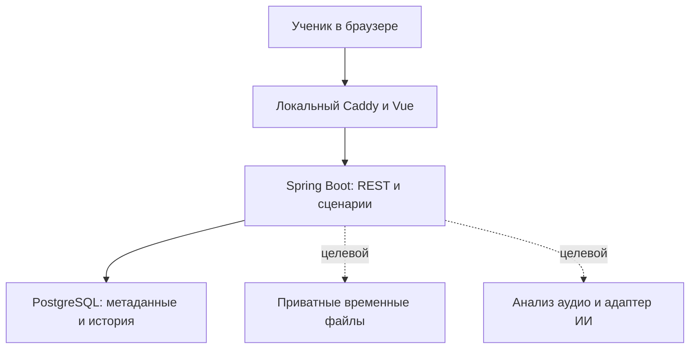
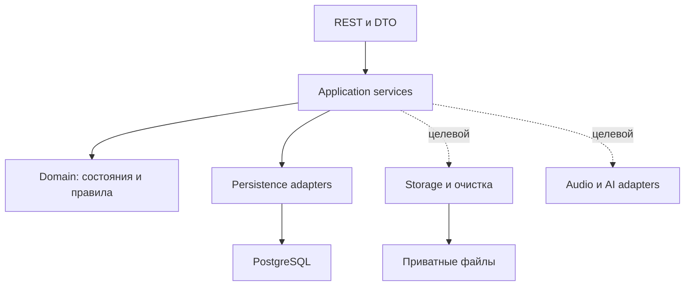
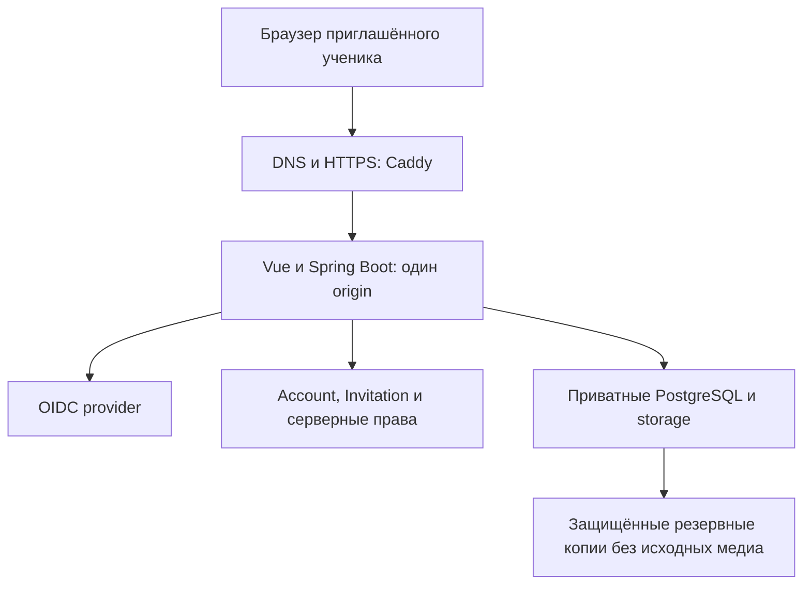

# Guitar Mentor AI — Архитектура и компоненты

| Версия | Дата | Что поменялось |
| --- | --- | --- |
| 0.2 | 18.10.2026 | Обновлена база на БТ/ТЗ 0.2; учтена главная и навигация US-009. |
| 0.1 | 18.10.2026 | Текущий локальный контур, целевые компоненты полного учебного цикла и граница будущего интернет-пилота. |

База: [ТЗ 0.2](../requirements/technical-specification.md), ADR-0001/0002/0003. Это схемы ответственности и направления развития; подпись «целевой» означает отсутствие заявления о реализации.

## Локальная архитектура M1

Loopback остаётся границей локального прототипа. Локальное имя и HTTPS описаны в инструкции Caddy; они не создают пользовательскую авторизацию. Медиабайты вне PostgreSQL/Git; доменные переходы выполняет Java. Подключение внешнего ИИ и отправка данных требуют отдельного интеграционного контракта.

## Компоненты backend

Application services определяют транзакции, владение и допустимые действия. Domain отделяет оценку агента от решения ученика. Инфраструктурные адаптеры реализуют хранение/интеграции; ИИ возвращает данные и рекомендации, но не выполняет бизнес-команды по своему решению. Одна кодовая база и БД обслуживают будущие интерфейсы; Telegram вне M1.

## Будущий интернет-пилот — отдельный эпик

Все компоненты интернет-схемы — целевая конфигурация US-007. Публичный доступ появляется только после приёмки аутентификации/объектных прав, приглашений, лимитов, резервирования и go/no-go. Схема не выбирает поставщиков и не поручает покупать ресурсы.

Исходники PlantUML: [архитектура](../diagrams/system-architecture.puml), [компоненты](../diagrams/backend-components.puml). Последовательности каждой US доступны из ТЗ.
