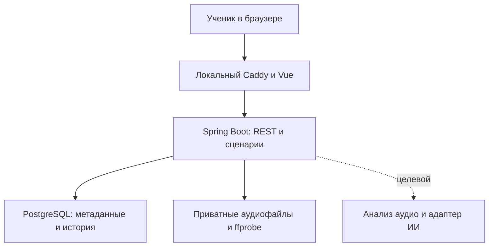
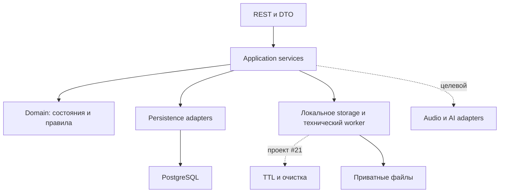
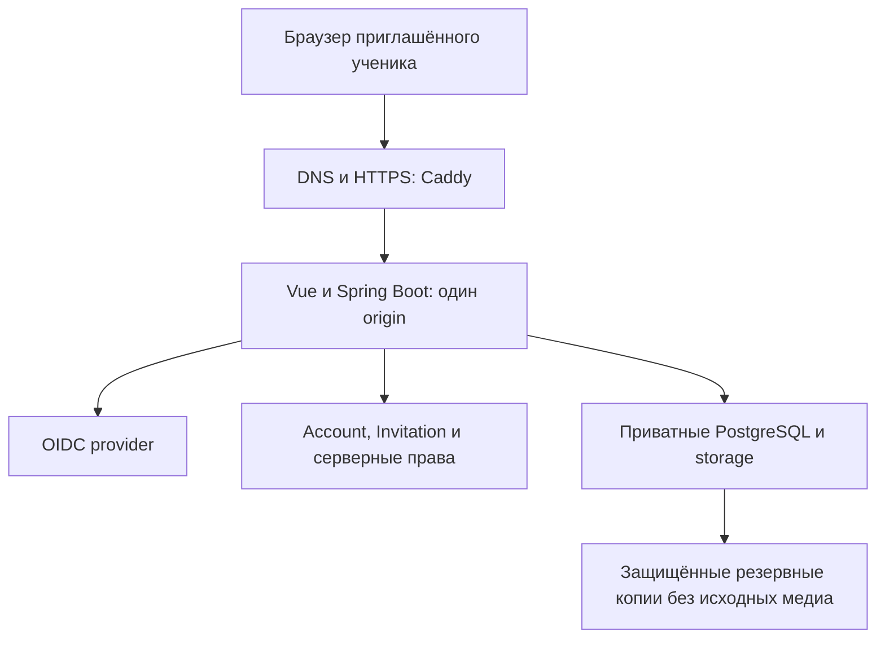

# Guitar Mentor AI — Архитектура и компоненты

| Версия | Дата | Что поменялось |
| --- | --- | --- |
| 0.4 | 19.10.2026 | Добавлен целевой локальный исследовательский контур #14 вне runtime приложения; ТЗ 0.7. |
| 0.3 | 19.10.2026 | Отделены существующие локальные файлы/ffprobe от будущих TTL и музыкального AI; база ТЗ 0.6. |
| 0.2 | 18.10.2026 | Обновлена база на БТ/ТЗ 0.2; учтена главная и навигация US-009. |
| 0.1 | 18.10.2026 | Текущий локальный контур, целевые компоненты полного учебного цикла и граница будущего интернет-пилота. |

База: [ТЗ 0.7](../requirements/technical-specification.md), ADR-0001/0002/0003. Это схемы ответственности и направления развития; подпись «целевой» означает отсутствие заявления о реализации.

## Локальная архитектура M1

Loopback остаётся границей локального прототипа. Локальное имя и HTTPS описаны в инструкции Caddy; они не создают пользовательскую авторизацию. Медиабайты вне PostgreSQL/Git; доменные переходы выполняет Java. Подключение внешнего ИИ и отправка данных требуют отдельного интеграционного контракта.

## Компоненты backend

В main уже есть Application/Domain/Persistence, LocalAttemptMediaStore и технический worker/ffprobe. Общий порт/rollback guard #30 написан в PR #69; TTL #21 ещё не реализован. Application services проверяют связность ресурсов; серверная авторизация отсутствует. Раздельные Assessment/решение ученика — целевое правило ADR-0003 для #18/#19. Инфраструктурные адаптеры реализуют хранение/интеграции; ИИ возвращает данные и рекомендации, но не выполняет бизнес-команды по своему решению. Одна кодовая база и БД обслуживают будущие интерфейсы; Telegram вне M1.

## Будущий интернет-пилот — отдельный эпик

Все компоненты интернет-схемы — целевая конфигурация US-007. Публичный доступ появляется только после приёмки аутентификации/объектных прав, приглашений, лимитов, резервирования и go/no-go. Схема не выбирает поставщиков и не поручает покупать ресурсы.

Исходники PlantUML: [архитектура](../diagrams/system-architecture.puml), [компоненты](../diagrams/backend-components.puml). Последовательности каждой US доступны из ТЗ.

## Исследовательский контур R2 (целевой, #14)

Вне runtime приложения: локальные оригиналы/эталон/ручная разметка → read-only аудит манифеста и целостности → безопасный протокол → PoC #15 и решение #31. [Схема компонентов](../diagrams/mvp-r2-01-benchmark-components.puml), [порядок проверки](../diagrams/mvp-r2-01-benchmark-sequence.puml), [контракт и границы](../specifications/MVP-R2-01-audio-feasibility.md). Это не микросервис, новый upload/БД или автоматический анализ. Корпус не экспортируется из product storage ради обхода TTL; исходники не публикуются. Принятый storage #30 в main c521786 не меняет эту границу.
