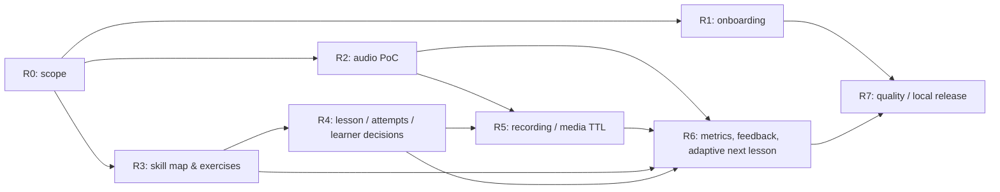

# Guitar Mentor AI — Roadmap MVP v1.0

**Дата:** 2026-10-18  
**Статус:** план для ревью, оценки предварительные  
**Контур:** Java 21 / Spring Boot 4.1 / PostgreSQL + Flyway / Vue 3 + TypeScript; персональный web MVP, локальный запуск. Telegram — после MVP.  
**Базовая единица:** 1 рабочий день = 6 часов сфокусированной разработки и проверки.

## 0. Результат MVP и границы

**MVP = законченный учебный цикл** для акустической гитары, с начальным фокусом на fingerstyle:

1. Ученик заполняет профиль, музыкальные предпочтения, опыт, цели и желаемое время практики.
2. Система предлагает обоснованный план из **существующих / авторских / свободно допустимых** упражнений, с явной картой навыков и критериями.
3. Ученик открывает упражнение, видит табулатуру/ноты (или подготовленное представление), рекомендуемый темп и задания; имеет базовое сопровождение темпа.
4. Сохраняет попытку: записывает или загружает аудио, видит ход обработки.
5. Получает проверку в границах *действительно доступных измерений* и понятные рекомендации ИИ; при ненадёжном анализе система прямо сообщает о его ограничениях.
6. Может повторить задание **или самостоятельно завершить его**, даже если агент предлагает повтор. Рекомендация/оценка агента, несданные критерии, решение ученика и причина перехода сохраняются раздельно. `COMPLETED_BY_LEARNER` не равен `COMPLETED_PASSED`: навык не получает подтверждения автоматически.
7. Результаты, незакрытые пробелы и рекомендации следующего урока сохраняются и учитываются при планировании.
8. Обработанные исходные медиа автоматически удаляются, но учебные данные и история остаются.

**Не входит в текущий web MVP:** Telegram bot / Mini App; универсальная транскрипция полифонического fingerstyle и безошибочное распознавание всех нот; автоматическая генерация полноценных аранжировок; видеоанализ рук; платформа преподавателей/платежей/массовых пользователей; публичный многоарендный сервис. Отдельная внешняя публикация требует аутентификации/авторизации, TLS и изоляции данных, а значит отдельной оценки.

**Архитектурные инварианты:** модульный Java-монолит; один PostgreSQL; Flyway; REST; Vue/JHipster-подобные разделы `entities`, `*.service.ts`, `shared/model`, `router`, `stores`, `i18n`; запрет секретов и исходных медиа в Git; расходы/хранение минимальны.

## 1. Сводная оценка остающейся работы

| Этап | Логическая контрольная точка | Issues | Дни (минимум–максимум) | Вход / выход |
| --- | --- | --- | ---: | --- |
| R0 | Область и Definition of Done | [#13](https://github.com/roafo1989/guitar-mentor-ai/issues/13) | 1–2 | Фиксированы in/out и демонстрационный сценарий |
| R1 | Доделан и принят onboarding | [#11](https://github.com/roafo1989/guitar-mentor-ai/issues/11), [PR #12](https://github.com/roafo1989/guitar-mentor-ai/pull/12) | 3–5 | Опыт, цели, репертуар, сохранение; локальная приёмка |
| R2 | Аудио-эксперимент / GO-LIMITED-NO-GO | [#14](https://github.com/roafo1989/guitar-mentor-ai/issues/14), [#15](https://github.com/roafo1989/guitar-mentor-ai/issues/15) | 5–8 | Проверена достоверность измерений, определены границы |
| R3 | Карта навыков и материалы | [#16](https://github.com/roafo1989/guitar-mentor-ai/issues/16), [#17](https://github.com/roafo1989/guitar-mentor-ai/issues/17) | 6–10 | Структурированная программа + первые 5 этюдов |
| R4 | Учебный цикл и web UI | [#18](https://github.com/roafo1989/guitar-mentor-ai/issues/18), [#19](https://github.com/roafo1989/guitar-mentor-ai/issues/19) | 6–10 | Урок → попытка → оценка → решение → история |
| R5 | Аудио, временное хранение, очистка | [#20](https://github.com/roafo1989/guitar-mentor-ai/issues/20), [#21](https://github.com/roafo1989/guitar-mentor-ai/issues/21) | 5–8 | Запись/загрузка и управляемый короткий TTL |
| R6 | ИИ-проверка и адаптация программы | [#22](https://github.com/roafo1989/guitar-mentor-ai/issues/22), [#23](https://github.com/roafo1989/guitar-mentor-ai/issues/23), [#24](https://github.com/roafo1989/guitar-mentor-ai/issues/24) | 10–16 | Надёжные метрики, объяснения, следующие задания |
| R7 | Стабилизация и локальный релиз | [#25](https://github.com/roafo1989/guitar-mentor-ai/issues/25), [#26](https://github.com/roafo1989/guitar-mentor-ai/issues/26), [#27](https://github.com/roafo1989/guitar-mentor-ai/issues/27) | 6–10 | Тесты, безопасный запуск, пилот, релиз |
| **ИТОГО** | **Функциональный MVP** | | **42–69** | **252–414 часов** |

Это *оценка оставшейся работы* на 18.10.2026, включая тесты, проверки и исправления; не включает долгие календарные перерывы. DEV-04 уже частично реализован в PR #12, поэтому диапазон R1 и общий итог следует уточнить после локальной приёмки. Для нового неизвестного аудиостека возможна дополнительная переоценка после R2.

### Календарные сценарии

- **6 часов в неделю:** примерно 42–69 календарных недель.
- **12 часов в неделю:** примерно 21–35 недель.
- **18 часов в неделю:** примерно 14–23 недели.
- **24 часа в неделю:** примерно 11–18 недель.

Формула: `ceil(оценка_в_днях * 6 / часов_в_неделю)`. Это не даты обещанного релиза, а иллюстрация пропускной способности.

## 2. Контрольные рубежи (логические Milestones)

> Это **проектные контрольные точки в документе**, не подтверждение наличия нативных Milestones в GitHub. Пока этапы отслеживаются по префиксам R0–R7 в Issues. Нативные Milestones можно создать в интерфейсе GitHub и затем привязать Issues.

### M0 — Learning loop prototype (ориентир: 18–25 дней разработки от начала дорожной карты)

- Профиль и onboarding сохраняются.
- Есть несколько коротких упражнений, карта навыков, экран урока и история попыток.
- Ученик может получить **ручную / явно демонстрационную** оценку, повторить или перейти дальше, без обмана о том, что аудио проверил ИИ.
- Ранний R2 выполняется параллельно разработке R3–R4, а не блокирует учебный CRUD.
- Цифра 18–25 дней — **целевой оптимистичный ориентир**, а не сумма всех R0–R5: при неудобных зависимостях/ошибках может сдвинуться. Работа на M0 — часть, не дополнение к 42–69 дням.

### M1 — Functional web MVP (ориентир: 42–69 дней)

- Всё из M0.
- Запись/загрузка аудио, получение оценки *в подтверждённых PoC границах*, персональные рекомендации, следующий урок.
- История оценок/решений сохраняется; исходные медиа удаляются по TTL.
- Интеграционные тесты зелёные, сквозной пилот пройден, локальный запуск документирован.

### M2 — Telegram (ПОСЛЕ M1, ориентир +5–8 дней)

Telegram как дополнительный адаптер к **тем же** Java application services/REST/базе; безопасная привязка личности ученика. **Не является условием M1.**

## 3. Зависимости / очередность

**Важный параллелизм:** R2 начинается как можно раньше, одновременно с завершением R1 и подготовкой R3; R4 можно разрабатывать с ручной оценкой без ожидания окончательного AI-алгоритма.

**Аудио-гейт R2:** если PoC не подтвердит достаточную точность конкретных метрик, не обещаем их в продукте. Функциональный MVP должен честно обозначать неопределённость. Результат LIMITED/NO-GO меняет объём R6 и запускает переоценку, а не маскируется уверенным текстом LLM.

## 4. Принятые продуктовые решения

| Область | Решение для MVP |
| --- | --- |
| Педагогическая модель | Гибридная: карта навыков и каталог упражнений + персональные рекомендации ИИ |
| Материалы | Собственные/разрешённые этюды, смешанные стили; короткие задания |
| Направление | Акустическая гитара, melodic fingerstyle без перкуссии, медиатора и thumbpick как основной сценарий первой версии |
| Решение ученика | `REVISE` от агента не запрещает переход. Несданные критерии сохраняются; навык не подтверждается автоматически |
| Медиа | Файлы вне БД/репозитория; обработанные удалить через 24 ч после финальной обработки всех критериев; необработанные — максимум через 48 ч после загрузки (начальные значения) |
| TTL-конфигурация | Настройки в PostgreSQL, изменение SQL применяется без рестарта; тестировать обработку гонок |
| Безопасность | До аутентификации только локальный loopback стенд, не публиковать API и Vue в интернет |
| Telegram | Следующий этап после M1 |
| Стоимость | Минимум сервисов; один Java backend + PostgreSQL; без Kubernetes и managed БД на старте |

## 5. Приоритет, учёт и правила работы

- `P0` — закрыть R0-01, завершить локальную проверку DEV-04 (#11 / PR #12), начать R2-01 и подготовку R3-01.
- `P1` — R3/R4, R5 и R6 по зависимостям и полученной точности PoC.
- `P2` — расширенный UX/репертуар, Telegram, публичный доступ, сложный нотный/видеоанализ — за пределами M1.

**Статусы задачи:** Backlog → Ready → In progress → Review/CI → Manual acceptance → Done (или Blocked). Не считать PR «Done», пока тесты/локальная приёмка, обозначенные в Issue, не подтверждены.

**Учёт каждой задачи:** `Estimate (days)`, `Actual (hours)`, `Remaining (hours)`, `Owner`, `Dependencies`, `Acceptance`, `Blockers`; фактические часы можно дописывать в Issue при закрытии. Начальные оценки есть в заголовках/описаниях задач; исполнителя по умолчанию не назначаем.

**Пересчёт:** после 5–10 принятых задач обновить план по реальным временным затратам и ошибке оценки. Отдельно пересмотреть R6 после PoC R2.

**Definition of Done для M1:**
- [ ] Новый/существующий ученик проходит onboarding, видит план и может открыть упражнение.
- [ ] Запись/загрузка привязана к попытке, статус обработки наблюдаем.
- [ ] Обратная связь согласуется с измерениями; сомнительные выводы помечены, галлюцинаций «распознанных нот» нет.
- [ ] `COMPLETED_BY_LEARNER` и `COMPLETED_PASSED` различимы в БД и UI; история/пробелы сохранены.
- [ ] Следующее упражнение предложено с учётом целей, предпочтений и результатов.
- [ ] История остаётся, бинарное медиа очищается по TTL.
- [ ] CI+интеграционные проверки проходят; секретов в Git нет.
- [ ] Локальный запуск и восстановление задокументированы, пилот принят, известные ограничения перечислены.

## 6. Уже сделано / риски

**Зафиксировано в GitHub:** bootstrap Java [PR #6](https://github.com/roafo1989/guitar-mentor-ai/pull/6), профиль REST [PR #8](https://github.com/roafo1989/guitar-mentor-ai/pull/8), Vue профиль [PR #10](https://github.com/roafo1989/guitar-mentor-ai/pull/10). Onboarding [PR #12](https://github.com/roafo1989/guitar-mentor-ai/pull/12) в ветке, автором указан прошедший CI, **необходима локальная проверка**. В Issues ещё присутствуют исторические Python/SQLite задачи, они относятся к заменённому эксперименту, не входят в текущий Java MVP.

**Риски:** (1) достоверность оценки полифонии; (2) авторское право на музыкальный материал; (3) приватность отправляемых в AI API записей; (4) несовместимость браузерных аудиоформатов; (5) временные ограничения при разработке по вечерам; (6) эксплуатационная безопасность локального стенда.

**Следующее действие:** выполнить критерии #13, завершить ручную приёмку #11 / PR #12 и параллельно начать #14. Далее пересчитать оставшееся по фактам.
