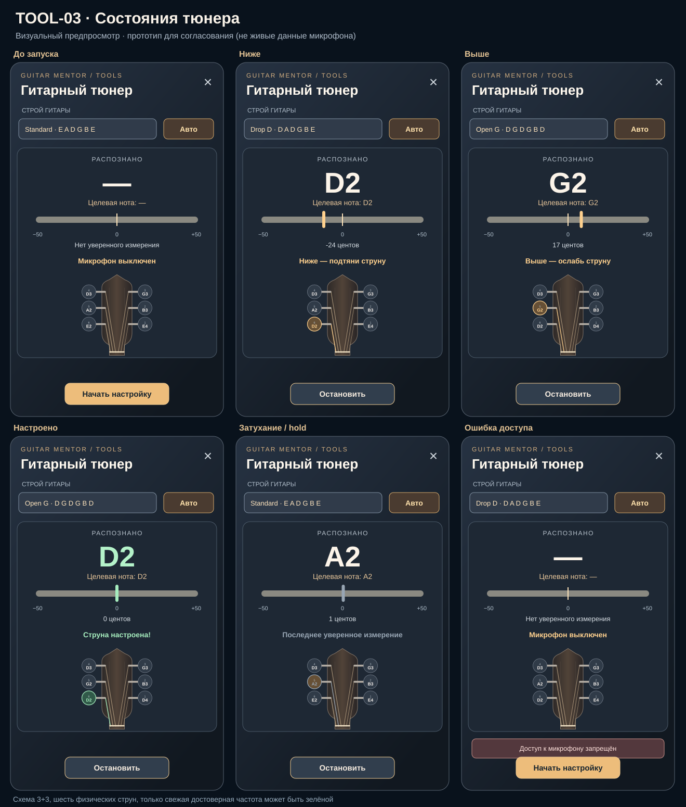
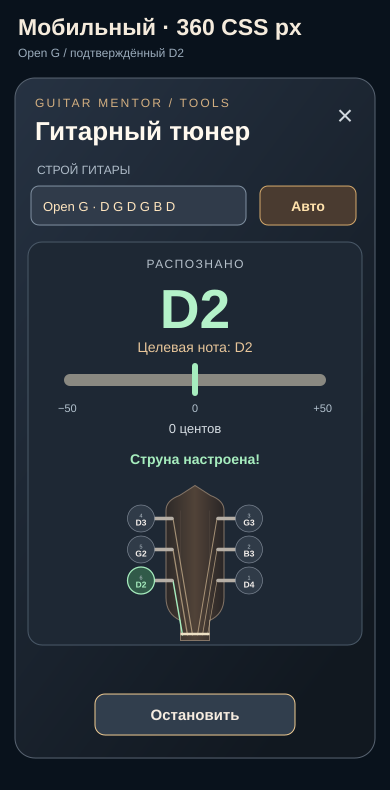

# TOOL-03 / #108 — Visual design preview (for owner review)

**Status: candidate design, not accepted.** The actual Vue/CSS tuner in PR #110 implements this instrument-inspired layout. These SVG previews are static state samples (not measurements), provided for review of visual hierarchy and desktop/mobile composition. Original repo-owned vector artwork; no borrowed brand assets.

## Desktop/state sheet

## Mobile (360 CSS px)

The panel intentionally uses a dark navy instrument surface, warm amber for selection, and green **only** for a fresh reliable in-tune signal. All six peg buttons carry physical string numbers and the target note with octave. These mock screens illustrate the planned visual treatment, not a screenshot from a running app.

**Owner acceptance still required:** verify actual application in a desktop browser and at 360 CSS px, including keyboard focus, accessibility, readability and scrolling. The live Vue implementation and these mockups must be compared visually before marking AC-TUI-01 PASS. Tests and screenshots cannot substitute for owner design sign-off.
